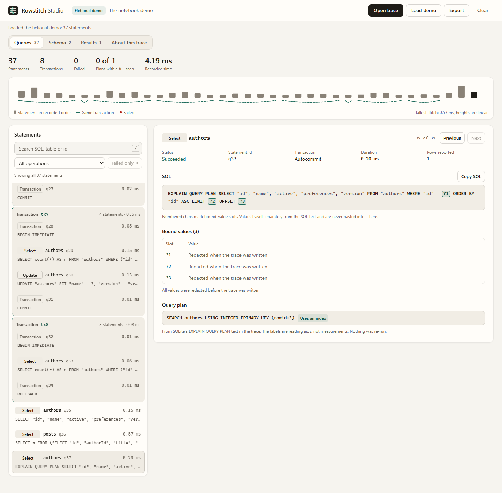

# Rowstitch

A small SQLite ORM for Node and TypeScript. Define your tables, load related rows in batches, and inspect the SQL your application actually ran.

Rowstitch has no runtime npm dependencies. It uses Node's built-in SQLite driver and includes a local, read-only query inspector. No account, AI subscription or API key is needed.

Use the library inside a Node app, such as a small inventory tool or a backend that stores related records in SQLite. Your app reads and writes through Rowstitch; the browser inspector helps you understand the SQL it ran. Coding assistants can follow the included integration instructions. There is no MCP server in the current package.



This release includes the 0.7.1 correction for related summaries with different filters. If you used those summaries on 0.7.0, upgrade and recheck affected saved results.

## Try the inspector

Use **Node 24.22.2+ or Node 26.13.0+ within those LTS release lines**. Run the prebuilt GitHub release:

```sh
npm exec --yes --package=https://github.com/Jgolding1998/rowstitch/releases/download/v0.9.0/rowstitch-0.9.0.tgz -- rowstitch demo
```

Or build from source:

```sh
git clone https://github.com/Jgolding1998/rowstitch.git
cd rowstitch
npm ci --ignore-scripts
npm run build
npm run demo
```

Open **http://127.0.0.1:4317**. The demo creates a fresh in-memory database with fictional authors and posts. Its SQL, results and version-conflict example come from the real ORM. Stop it with Ctrl+C. Use `node dist/cli.js demo --port 4318` if the port is occupied.

The inspector lets you search queries, follow transactions, examine parameterized SQL and query plans, and read the schema. You can open a Rowstitch trace JSON file in the browser; imported SQL is displayed, never executed. The file stays in browser memory and is not uploaded to the local server.

## Use it in an application

Install the versioned release in your project. It is distributed through GitHub releases, not the npm registry:

```sh
npm install --save-exact https://github.com/Jgolding1998/rowstitch/releases/download/v0.9.0/rowstitch-0.9.0.tgz
```

```ts
import { column, defineTable, openDatabase, eq } from 'rowstitch';

const authors = defineTable('authors', {
  id: column.integer().primaryKey({ generated: true }),
  name: column.text(),
  version: column.integer().default(1),
}, { version: 'version' });

const db = openDatabase('notes.sqlite', { tables: [authors] });
db.ensureSchema();

const author = db.table(authors).insert({ name: 'Avery' });
db.table(authors).updateVersion({ id: author.id }, 1, { name: 'Avery Lee' });
const saved = db.table(authors).findFirst({ where: eq(authors.col('id'), author.id) });
console.log(saved?.name); // Avery Lee
db.close();
```

`updateVersion` checks the version and increments it atomically. A stale save raises `ConflictError`; it does not overwrite the newer row. Ordinary updates and deletes require a meaningful filter and use an affected-row limit inside a transaction. Primary keys and version fields cannot be patched directly.

See [examples/basic.mjs](examples/basic.mjs) for transactions and trace export. [examples/relations.mjs](examples/relations.mjs) shows one-to-one, many-to-one and one-to-many reads with selected fields. [Agent instructions](docs/agent-instructions.md) describe a safe integration workflow for coding assistants.

### Use async queries

Use `openAsyncDatabase` when SQLite work should run in a background worker. It uses the same table definitions, filters, relationships and aggregate selectors. Await database operations and close the connection when finished:

```ts
import { column, defineTable, openAsyncDatabase } from 'rowstitch';

const notes = defineTable('notes', {
  id: column.integer().primaryKey({ generated: true }),
  title: column.text(),
});
const db = await openAsyncDatabase('notes.sqlite', { tables: [notes] });
try {
  await db.ensureSchema();
  await db.transaction(async tx => {
    await tx.table(notes).insert({ title: 'Moon garden' });
  });
  console.log(await db.table(notes).findMany());
} finally {
  await db.close();
}
```

`table()`, the compile methods, `clearTrace()` and `exportTrace()` remain synchronous. Async trace export uses the most recently inspected schema and states when it was captured. Query execution runs in the worker; planning and decoding still run on the calling thread.

Await each write inside a transaction, or use `insertMany` for a batch. Concurrent writes inside the same callback are refused because they would overlap savepoints. Work from outside the callback queues separately. Unfinished work at callback settlement is drained and rolled back; a lost COMMIT response raises `COMMIT_UNCONFIRMED` and must be reconciled before retrying. The [async example](examples/async.mjs) and [driver guide](docs/async-drivers.md) cover ownership, cancellation, limits and trace interpretation.

## Read connected records

Use `hasMany` for a list, `hasOne` for a single owned record, and `belongsTo` to follow a reference. Relations load in batches. A missing singular relation returns `null`; more than one matching record raises `RELATION_CARDINALITY` instead of silently picking one.

`select: ['name']` returns only the named columns, alongside any explicitly included relations. SQL may also read keys needed to join the records; those internal keys do not appear in the returned object. Select fields separately on each relation; omitting `select` returns every mapped column. This is a query feature, not an authorization system.

Literal selection tuples infer exactly those fields. When the selection is a dynamic array or a tuple slot can name different fields, TypeScript marks uncertain fields optional. Check those fields before using them; a field listed in the array's type is not necessarily present in its value.

Text-key relationships retain SQLite's comparison rules, including existing `NOCASE` and `RTRIM` collations. Matching and per-parent pagination happen in SQL; hidden correlation keys are removed from returned records. One child can match multiple parent keys under a collation, and each returned match counts toward the related-row limits.

## Filter by related records

`some`, `none` and `every` filter rows by their related records without loading them. They reuse a `hasMany`, `hasOne` or `belongsTo` descriptor and compile to a correlated `EXISTS` subquery:

```ts
import { and, eq, every, hasMany, none, some } from 'rowstitch';

const openTasks = hasMany(tasks, {
  localKey: projects.col('id'), foreignKey: tasks.col('projectId'),
  where: eq(tasks.col('archived'), false),
});

const active = db.table(projects).findMany({ where: some(openTasks) });
const idle = db.table(projects).count(none(openTasks));
const finished = db.table(projects).findMany({
  where: and(some(openTasks), every(openTasks, eq(tasks.col('done'), true))),
});
```

- `some(relation, test?)` is true when at least one related row passes `test`. Without a test it means "has a related row".
- `none(relation, test?)` is exactly `not(some(relation, test))`.
- `every(relation, test)` requires a test. A related row must make it TRUE; a NULL (unknown) result counts as a failure. A row with **no** related rows passes `every`, including a row whose local key is NULL. Combine it with `some(relation)` when at least one related row is required, as above.

The descriptor's `where` defines which related rows are considered. Descriptor options that only make sense for loading (`orderBy`, `limit`, `offset`, `include`, `select`) are rejected rather than ignored. Test predicates must reference the related table. Filters can be nested up to four relationships deep and combined with `and`, `or` and `not`; they work in `findMany`, `findFirst`, `count`, `compileSelect`, `explain` and in a relation's own `where`.

On a `hasOne` or `belongsTo` descriptor, `some` and `none` only check existence; they do not detect several matching rows. Loading the same descriptor with `include` still raises `RELATION_CARDINALITY` for duplicates.

Relation filters are read-only for now. `update` and `delete` refuse them with `UNSAFE_WRITE`. If you need a read-then-write operation, select explicit keys and perform the key-filtered write with `maxRows` inside the same synchronous transaction. Every table used by a filter must be registered with `openDatabase`. Keys must be integer/bigint or text/text pairs; text keys follow the related column's collation, the same rule eager loading uses.

These subqueries can require a lookup for each parent row, so index the related key. `ensureSchema()` creates an index for a column declared with `.references(...)`. A relation descriptor alone does not create one, so add your own index for relations on undeclared keys, then check `explain()`. Try the complete [relation-filter example](examples/relation-filters.mjs), or reproduce the [Orange comparison](benchmarks/README.md#relation-predicates).

## Filter by how many related records match

Use `countRelated` for questions such as "which projects have at least two unfinished tasks?":

```ts
import { countRelated, eq } from 'rowstitch';

const busy = db.table(projects).findMany({
  where: countRelated(openTasks, '>=', 2, eq(tasks.col('done'), false)),
});
```

The relation's `where` still defines the domain. The optional last argument narrows the count to rows where that test is TRUE. Without it, every related row counts, including one with NULL values. Empty relations count as zero. This uses SQL `COUNT(*)` without loading the children, so the eager-loading row limit does not truncate the count.

Choose `=`, `<>`, `>`, `>=`, `<` or `<=` and a nonnegative safe integer threshold. Counts share the relation filters' registration, key, collation, nesting and read-only rules. A singular descriptor counts its actual matching rows too; it does not clamp duplicates to one. Including that singular relation still checks cardinality.

Use `some` or `none` when you only need to know whether a match exists; those queries can stop at the first match. A count may scan the full matching range. This API filters the returned parents; it does not add a count field to each result or provide grouping or distinct counts. See [the runnable example](examples/related-counts.mjs) and [the count comparison](benchmarks/README.md#filtered-relation-counts).

## Calculate totals and grouped results

Use `agg` selectors with `aggregate` for one summary, or `groupBy` for a summary per key. For a mapped orders table:

```ts
import { agg, eq } from 'rowstitch';

const paid = eq(orders.col('paid'), true);
const totals = db.table(orders).aggregate({
  where: paid,
  select: { orders: agg.count(), totalCents: agg.sum(orders.col('cents')) },
});
const categories = db.table(orders).groupBy({
  by: ['category'], where: paid,
  select: { orders: agg.count(), totalCents: agg.sum(orders.col('cents')) },
  orderBy: [{ field: 'totalCents', direction: 'desc' }],
});
```

`aggregate` returns one object even when nothing matches. `groupBy` returns an array, empty when nothing matches. `agg.count()` counts rows; `agg.count(column)` counts non-NULL values. The other selectors skip NULL inputs and return `null` when there are no values. Select at least one aggregate and group by at least one key. See the complete [paid-orders example](examples/aggregates.mjs).

| Selector | Result |
| --- | --- |
| `agg.count()` or `agg.count(column)` | A safe JavaScript number |
| `agg.sum(integerOrBigintColumn)` | Exact `bigint`, or `null` |
| `agg.sum(realColumn)` | Finite approximate number, or `null` |
| `agg.avg(integerOrRealColumn)` | Finite approximate number, or `null` |
| `agg.avg(bigintColumn, { approximate: true })` | Finite approximate number, or `null`; integer precision can be lost |
| `agg.min(column)` / `agg.max(column)` | The column's scalar value type, or `null` |

Integer totals can exceed int64 even though each stored value must fit its column. The SQLite compiler adds high and low portions separately to avoid native SUM's intermediate overflow on ordinary datasets. Those partial sums still have SQLite's limits; this is not an unlimited-size guarantee. Bigint results need an explicit conversion when preparing JSON. Real sums and averages remain approximate and reject nonfinite results.

Grouped ordering names selected keys or aggregate aliases, not row references. Missing group keys are appended as tie-breakers. SQLite puts NULL first in ascending order and last in descending order. Text grouping and extrema use the declared column collation; equivalent strings can share a group with a representative spelling chosen by SQLite.

Without an explicit `limit`, more than 10,000 groups raises `RESULT_LIMIT`; supplying only `offset` keeps that cap on the remaining results. Set `limit` and `offset` to request a page. The current bounds are 32 aggregate selectors, 16 group keys and 10,000 returned groups. `compileAggregate`/`compileGroupBy` expose SQL and parameters; `explainAggregate`/`explainGroupBy` return query plans. Compiled parameters are not redacted, so keep them private.

The same query checks the storage types of referenced columns, including grouped keys and counted columns. A returned group also carries a check across the other filtered groups before pagination. This catches cases where SQLite could otherwise turn malformed stored input into a plausible total. An empty page carries no such check; it is not evidence that the underlying data is valid. `count()` does not inspect unrelated columns. If the implicit group cap is exceeded, `RESULT_LIMIT` takes precedence over decoding the data-check flag.

Root summaries and grouped summaries share one `where`, including relationship predicates, and also accept `agg.related` selectors (described below). HAVING, DISTINCT and a separate filter per selector are not yet supported; those options are refused. Per-row related totals are available in `findMany`, as described below.

### Related totals on each row

`agg.related(relation, selector)` adds an aggregate over related records to every row that `findMany` or `findFirst` returns, without loading those records. Nest it to follow a path of up to four relations:

```ts
const orderLines = hasMany(lines, { localKey: orders.col('id'), foreignKey: lines.col('orderId') });
const openOrders = hasMany(orders, { localKey: customers.col('id'), foreignKey: orders.col('customerId'), where: eq(orders.col('status'), 'open') });
const rows = db.table(customers).findMany({ select: ['name'], aggregates: {
  openOrders: agg.related(openOrders, agg.count()),                                        // 0 when there are none
  openCents: agg.related(openOrders, agg.related(orderLines, agg.sum(lines.col('cents')))), // exact bigint, or null
} });
```

- **Domains and loading options:** a relation's `where` limits which records count. Loading options (`orderBy`, `limit`, `offset`, `include`, `select`) are refused.
- **Path semantics:** each selector aggregates every matching path through its relations. A record reached twice counts twice, and averages are taken over those leaf records rather than averaged per parent. Independent selectors are computed separately and never multiply each other.
- **Result types:** counts, exact integer sums, approximate averages and nullable extrema follow the selector table above. Text keys and min/max follow the related column's declared collation.
- **Aliases:** they must not repeat a selected column or include name, ignoring case.
- **Dynamic aliases:** a broad (dynamically built) alias record does not promise any field. A dynamic lookup may return a selected column or an included array as well as an aggregate.
- **Stored data check:** the same query checks the stored types of related keys and aggregated columns on matched rows, and fetches each correlation key internally, but only for the rows it returns.
- **Where it works:** use `findMany`/`findFirst` for per-row summaries (plus `compileSelect`/`explain`), or the summary methods below for root/group totals. Plain `agg` selectors are always refused per row. Each selector uses correlated subqueries per returned row, so index the related key columns and check `explain()`. See the [related totals example](examples/projected-aggregates.mjs).

### Related totals in summaries and groups

Use `agg.related` inside `aggregate` and `groupBy`, next to ordinary root selectors:

```ts
const regionSales = hasMany(sales, { localKey: shops.col('id'), foreignKey: sales.col('shopId') });
const byRegion = db.table(shops).groupBy({ by: ['region'], select: {
  shops: agg.count(),                                                // root rows in the group
  sales: agg.related(regionSales, agg.count()),                      // related rows of those shops; 0 when none
  cents: agg.related(regionSales, agg.sum(sales.col('cents'))),      // exact bigint, or null
}, orderBy: [{ field: 'cents', direction: 'desc' }] });
```

- **What a related value covers:** every matching related path from **all** root rows of the group (or of the whole filtered table for `aggregate`). The root `where` applies to both.
- **No multiplication:** each related selector is its own subquery, so related tables never join the grouped query. Independent collections cannot multiply each other or the root selectors.
- **Values:** averages use all matching leaf records, integer totals are exact bigint values, and min/max use the related column's own collation.
- **Grouping and ordering:** groups match by their keys using the key column's collation, including the NULL group. Ordering may name related aliases, and pagination applies to groups.
- **Cost:** the root `where` is repeated for every related selector and for its stored-data check, and those copies count toward the 10,000-value limit. For example, a 2,000-value `IN` filter fits two related counts but not three.
- **Stored-data check:** the same statement checks related keys and aggregated columns across the whole filtered domain, including groups outside the returned page, plus each relation's root key.
- **Not supported:** HAVING, DISTINCT, per-selector filters and grouping by a related column are refused. Averages always use leaf records; an average of per-parent averages is not offered.

See the [grouped related totals example](examples/grouped-related.mjs). JSON is excluded from grouping and column aggregates; min/max accept numeric or text columns. A column from another table is rejected at runtime, since column-reference types do not encode table identity.

## Search text and ranges

Use `contains`, `startsWith` and `endsWith` for literal text. A percent sign means a percent sign; it does not become a wildcard. For a mapped `posts` table with a title and numeric ID:

```ts
import { and, startsWith, between } from 'rowstitch';

const drafts = db.table(posts).findMany({
  where: and(
    startsWith(posts.col('title'), 'draft:', { case: 'ascii-insensitive' }),
    between(posts.col('id'), 10, 20),
  ),
});
```

Matching is case-sensitive by default. The explicit ASCII option folds A-Z only, without Unicode normalization or locale rules. Needles must be nonempty, well-formed strings of at most 4,096 UTF-16 code units. Empty searches are rejected to avoid accidental broad filters. Embedded null characters are supported. A null field matches neither a search nor its negation; combine with `isNull` when null rows should be included.

`between` includes both endpoints and accepts text, integer, real and bigint columns with matching non-null bounds. Text ranges follow the database column's ordering, which can depend on its collation and encoding. Reversed bounds are not rearranged. Literal matching may scan rows; use `explain()` to inspect the actual plan. See [the runnable filter example](examples/literal-filters.mjs).

Keep column and reference types inferred from their factories. An explicit reference annotation needs its codec, for example `ColumnRef<string | null, 'text'>`; a broad `ColumnRef<string>` or `Column<string>` annotation loses the information these new helpers require. Ordinary value predicates keep their existing typing.

Even a nonempty search can match many rows. Updates and deletes still use the atomic `maxRows` limit, and application authorization remains the caller's responsibility.

## Compare two columns

Use `eqColumns`, `neColumns`, `gtColumns`, `gteColumns`, `ltColumns` and `lteColumns` when both operands are mapped columns in the same table. For example, a supplies table can find shortages directly in SQL:

```ts
import { ltColumns } from 'rowstitch';

const shortage = ltColumns(supplies.col('available'), supplies.col('needed'));
const rows = db.table(supplies).findMany({ where: shortage });
db.table(supplies).update({ reorder: true }, { where: shortage, maxRows: 20 });
```

Integer, bigint and real columns can be compared with each other without converting bigint values to JavaScript numbers. Stored real values remain approximate. Text compares with text; booleans support equality and inequality only. JSON, comparisons between tables and self-comparisons are rejected. A NULL operand remains unknown, including under NOT; use explicit NULL predicates when needed.

Existing text columns keep SQLite's collation rules. When two columns declare different collations, the left column's collation takes precedence, so reversing operands can change the result. Text ordering can also depend on the database encoding. See [the runnable inventory example](examples/column-comparisons.mjs).

Each helper reads left to right: `gtColumns(a, b)` means `a > b`. Different columns can still compare true for every row, so retain a deliberate write limit. These queries may scan rows; check `explain()` before assuming an index helps.

## Inspect an existing schema

```sh
node dist/cli.js schema path/to/database.sqlite
```

This command opens the named file read-only and prints schema metadata as JSON. It does not copy application rows or create a missing database. It is an inspection report, not a complete model-code generator.

`planSchema()` describes missing tables and declared indexes without applying them. `ensureSchema()` creates compatible missing objects atomically and rejects detected drift. Neither generates destructive migrations, rebuilds tables or silently drops data. Back up a real database before adopting any new database library.

The schema report and drift checks do not currently identify column collations. Existing `NOCASE` or `RTRIM` columns can change equality, ordering and uniqueness behavior. Literal text searches keep their explicitly chosen case behavior, so they can differ from equality on those columns. Review the existing schema's declarations when those distinctions matter.

## Trace your own code

```ts
import { writeFileSync } from 'node:fs';

// After performing operations with db:
writeFileSync('trace.json', JSON.stringify(db.exportTrace({ title: 'A local session' })));
```

Bound values are redacted at collection by default and result rows are not collected. Trace history defaults to 200 statements with a separate 1 MiB byte limit. Exports fit within 2 MiB by dropping old statements; an oversized schema raises a clear error. Omitted history is noted in the export. SQL, schema names and literal defaults can still reveal information. **Redaction is not anonymization.** Review a trace before sharing it. Compiled-query APIs deliberately return their parameters to your code; keep that output private too.

Trace statuses describe individual SQL statements. An ORM call can still reject a stale edit or ambiguous relationship after its SQL succeeds. Those application-level failures do not yet appear as separate trace events, so zero failed statements does not mean every API call succeeded.

Studio separately shows a write's effect in the recorded transaction: committed, undone, unfinished or unknown. Released savepoints remain subject to an outer rollback. These labels are inferred from recognized transaction statements in the file; missing or inconsistent boundaries stay unknown. They do not certify the current database state or whether an application call succeeded. Edited traces can give misleading results.

## Scope and checks

This release supports SQLite through synchronous and async APIs. The async API executes SQLite operations in a background worker; its transactions await async callbacks. It is an independent implementation, with a [feature comparison and development plan](docs/compatibility.md). It does not yet provide Orange's full feature set, public drivers for other databases, a migration history runner, nested graph writes, a remote database API or an authorization system. Identifiers use simple names of at most 63 characters. Use the dedicated bigint column for integers beyond JavaScript's safe range.

JSON reads and writes accept finite JSON data within the same depth and node limits. Stored JSON text is limited to 1,048,576 characters before parsing; oversized, invalid or out-of-domain stored values raise a `DATA` error. This also applies to existing databases populated by another tool.

JSON numbers use JavaScript number semantics: a large integer can lose precision even when it is finite. Store exact large values as JSON strings or in a mapped `bigint` column. The structure limit counts the root at depth zero and rejects any value beyond depth 64 or 100,000 total nodes.

```sh
npm test
npm run test:types
npx playwright install chromium
npm run test:browser
```

Tests use temporary or in-memory fictional databases. The [comparison harness](benchmarks/README.md) records correctness and relationship query counts against pinned public libraries. Different SQLite driver versions are disclosed; no blanket speed or security ranking is claimed. [Research notes](docs/research.md) explain which upstream discussions informed the tests. [SECURITY.md](SECURITY.md) defines the trust boundary and remaining limits.

Contributors working on the internal PostgreSQL transaction boundary can also run the optional [live engine checks](tests/integration/README.md). Those tests do not make PostgreSQL or PGlite available through the public ORM.

Claude Code leads the inspector's UI and UX. Codex coordinates the core implementation, independent reviews, testing and packaging. The source and branding are original; the project is inspired by public work, not affiliated with those maintainers. See [third-party notices](THIRD_PARTY_NOTICES.md).

MIT licensed. Maintained by [Jgolding1998](https://github.com/Jgolding1998).
